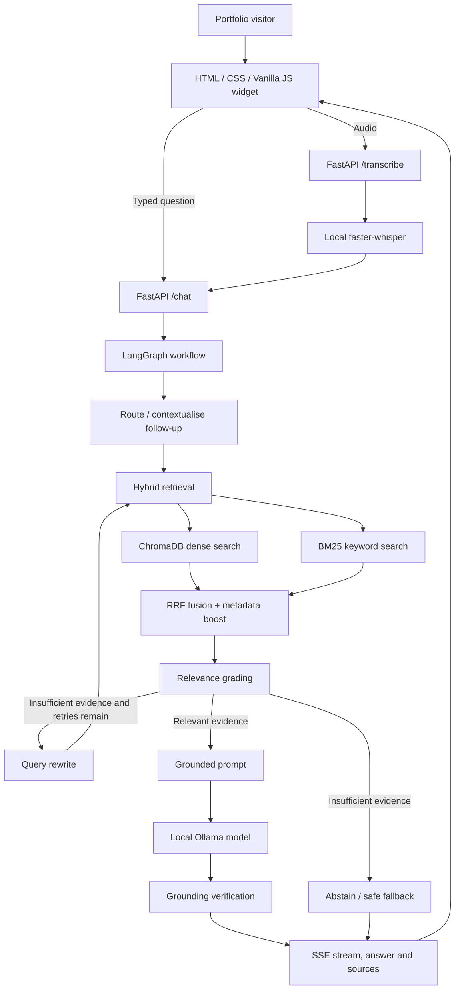

<div align="center">

# NEXUS
### A Local-First Voice AI Portfolio Assistant

**Your portfolio, conversational. Your data, local-first.**

A voice-enabled AI assistant that helps recruiters explore projects, skills, experience, and certifications through natural conversation—powered by a retrieval-augmented generation (RAG) pipeline and a local LLM.

[Features](#-features) · [Architecture](#-architecture) · [Quick Start](#-quick-start) · [Evaluation](#-evaluation) · [Project Structure](#-project-structure)

</div>

---

## ✨ Overview

NEXUS turns a static developer portfolio into an interactive experience. Visitors can type a question or speak to the assistant instead of manually navigating every section. The assistant retrieves relevant information from a curated portfolio knowledge base, generates a grounded answer, and can expose the sources and processing trace behind its response.

The project is designed around **local-first AI**: the main retrieval, language-model, and speech-recognition pipeline can run on your own machine without a paid cloud AI API. Optional integrations—such as live GitHub repository lookup—may require network access.

### What can visitors ask?

- “Give me an overview of the AI Proposal Evaluator.”
- “Which technologies does ColdMail AI use?”
- “How does NEXUS combine vector search and keyword search?”
- “What projects demonstrate his GenAI skills?”
- “How can I contact Kavya?”
- “What information do you have about this assistant?”

NEXUS should decline to invent details that are absent from the knowledge base. Its answers depend on the quality and freshness of the underlying knowledge files and on the configured local model.

## 🚀 Features

| Capability | Implementation |
|---|---|
| Voice and text interaction | Portfolio widget with microphone input, typed questions, and spoken responses |
| Local speech recognition | `faster-whisper` through the FastAPI transcription endpoint |
| Local LLM inference | Ollama-compatible model, configurable through environment variables |
| Retrieval-augmented generation | Answers grounded in Markdown knowledge files |
| Hybrid retrieval | ChromaDB dense retrieval + BM25 lexical retrieval |
| Rank fusion | Reciprocal Rank Fusion (RRF), with metadata/tag-aware boosting |
| Corrective retrieval workflow | LangGraph routing, relevance grading, query rewriting, and bounded retries |
| Follow-up questions | Uses conversation history to contextualise references such as “it” or “that project” |
| Source transparency | UI can display retrieved sources and a trace of the answer pipeline |
| Grounding guard | Checks selected answer details against retrieved source material and can fall back to extractive text |
| Optional reranking | Cross-encoder reranking, configurable and disabled by default |
| Optional GitHub lookup | Live repository metadata lookup; requires network access |
| Evaluation harness | Retrieval ranking and off-topic refusal checks; optional LLM-backed answer evaluation |
| Portfolio integration | Existing HTML, CSS, and Vanilla JavaScript frontend—no React requirement |

## 🧠 Architecture



### Request lifecycle

1. The visitor types a question or records audio.
2. Audio is transcribed locally by the configured speech-recognition backend.
3. FastAPI validates the request and streams progress and response events.
4. LangGraph routes the question and resolves follow-ups when appropriate.
5. The retriever combines dense and lexical results using RRF and metadata hints.
6. The workflow grades the retrieved evidence and may rewrite the query within a configured limit.
7. The local LLM generates a source-grounded response when suitable evidence exists.
8. The backend verifies selected claims and returns the answer, source information, and processing trace.
9. The browser displays the answer and can speak it using the browser's speech-synthesis support.

> **Local-first note:** the main AI pipeline does not require a paid cloud LLM API. The optional GitHub live lookup requires network access. Browser speech synthesis may use OS/browser-provided voices; fully offline TTS behaviour can vary by environment.

## 🧰 Technology Stack

- **Frontend:** HTML, CSS, Vanilla JavaScript
- **API:** Python, FastAPI, Uvicorn
- **Agent workflow:** LangGraph
- **LLM runtime:** Ollama
- **Retrieval:** ChromaDB, BM25, Reciprocal Rank Fusion
- **Embeddings:** Sentence Transformers (`all-MiniLM-L6-v2` by default)
- **Speech-to-text:** faster-whisper
- **Testing:** pytest
- **Evaluation:** custom offline retrieval/refusal evaluation harness
- **Packaging:** Docker configuration and a local macOS startup script

## ⚡ Quick Start

### Prerequisites

- macOS with Apple Silicon or another supported Python environment
- Python 3.11+ (Python 3.12 may work depending on dependency compatibility)
- [Ollama](https://ollama.com/) installed and running
- A local model pulled into Ollama
- Internet access for first-time installation and model downloads; runtime use can then be local except optional live integrations

### 1. Get the project

```bash
git clone <your-repository-url>
cd <repository-folder>
```

Or download and extract the project ZIP.

### 2. Start Ollama and pull a model

```bash
ollama pull llama3:latest
ollama list
```

If you already have a compatible model, configure its exact name using `LLM_MODEL`.

### 3. Set up the backend

```bash
cd voice-agent
python3 -m venv .venv
source .venv/bin/activate
python -m pip install --upgrade pip
pip install -r requirements.txt
```

Copy the sample environment file if you want to customise settings:

```bash
cp .env.example .env
```

The application reads configuration from environment variables. If your project does not load `.env` automatically, export the variables in your shell or use your preferred environment loader.

### 4. Build the local knowledge index

Run from the `voice-agent` directory with the virtual environment active:

```bash
python -m app.ingest
```

This indexes the Markdown files in `voice-agent/knowledge/`. The initial embedding-model download may require internet access.

### 5. Run the API

```bash
uvicorn app.main:app --host 127.0.0.1 --port 8000 --reload
```

Check the health endpoint documented by the API implementation, or open the interactive API docs at:

```text
http://127.0.0.1:8000/docs
```

### 6. Run the portfolio

Open a second terminal from the repository root:

```bash
cd kavya2
python3 -m http.server 5500
```

Then open:

```text
http://127.0.0.1:5500
```

Use the **Talk to my AI assistant** entry point to open NEXUS. Keep the backend running while testing the connected AI experience.

### macOS shortcut

The repository includes `START-LOCAL-MAC.command`. Review its contents and the setup instructions before running it; it may expect dependencies and local services to be installed already.

## ⚙️ Configuration

The main settings live in `voice-agent/app/config.py`. Common environment variables include:

| Variable | Default | Purpose |
|---|---|---|
| `LLM_BASE_URL` | `http://localhost:11434` | Ollama endpoint |
| `LLM_MODEL` | `llama3:latest` | Local model name |
| `LLM_TEMPERATURE` | `0.2` | Generation temperature |
| `LLM_MAX_TOKENS` | `220` | Maximum generated tokens |
| `LLM_TIMEOUT_SECONDS` | `90` | LLM request timeout |
| `EMBED_MODEL` | `sentence-transformers/all-MiniLM-L6-v2` | Embedding model |
| `TOP_K` | `3` | Number of final retrieval results |
| `CANDIDATES` | `10` | Candidate count before fusion/ranking |
| `MAX_REWRITES` | `1` | Maximum query rewrites |
| `MAX_GRAPH_STEPS` | `12` | Graph execution limit |
| `MAX_HISTORY_TURNS` | `6` | Conversation history limit |
| `WHISPER_MODEL` | `base.en` | faster-whisper model |
| `RERANK` | `0` | Enable optional cross-encoder reranking |
| `RERANK_MODEL` | `cross-encoder/ms-marco-MiniLM-L-6-v2` | Optional reranker |
| `MAX_QUESTION_CHARS` | `400` | Input length limit |
| `RATE_LIMIT_PER_MIN` | `30` | Per-IP request limit |

See `.env.example` and `app/config.py` for the complete current configuration. Keep local endpoints bound to loopback for personal development unless you have intentionally configured secure access.

## 📚 Updating the Knowledge Base

NEXUS uses Markdown files in `voice-agent/knowledge/` as its source of truth. Update these files when project details, skills, certifications, links, or biographical details change.

1. Edit the relevant Markdown file or add a new one.
2. Use factual, clearly labelled content; distinguish implemented features from planned ideas.
3. Rebuild the index:

   ```bash
   cd voice-agent
   python -m app.ingest
   ```

4. Restart the backend if required and test representative questions.

The profile and assistant knowledge should use **he/him/his** for Kavya. Avoid putting unsupported claims or private data in the knowledge base.

## 🧪 Testing

Run tests from the `voice-agent` directory with its virtual environment active:

```bash
pytest -q
```

Run the offline evaluation harness:

```bash
python -m eval.run_eval
```

Run the optional evaluation path that also uses the local Ollama model:

```bash
python -m eval.run_eval --llm
```

The evaluation harness writes a report to `voice-agent/eval/results.md`. Generate this report on the target machine and commit it only if the results are reproducible and you are comfortable publishing the measured configuration.

### What is measured?

- **Hit@1 / Hit@3:** whether the expected document appears first or within the top three results
- **MRR:** ranking quality of the expected document
- **Off-topic refusal accuracy:** whether out-of-scope questions are declined rather than answered with unrelated portfolio content
- **Optional LLM evaluation:** verified-answer rate, extractive fallback count, and answer latency

These are evaluation capabilities, not pre-claimed results. No accuracy or latency figures are asserted here because they must be measured on the machine and model configuration used for the demo.

## 🔐 Privacy, Safety, and Limitations

- The core LLM and embedding workflow can run locally after dependencies and models are downloaded.
- Optional live GitHub lookup uses the network.
- Keep the API bound to localhost for personal use; do not expose it publicly without reviewing authentication, CORS, rate limits, and deployment security.
- Treat retrieved knowledge files as data, not instructions.
- Tool access should remain explicitly allowlisted and read-only.
- The browser provides the interface; the local backend performs retrieval and generation.
- Speech quality, latency, and memory usage depend on the selected model and hardware.
- Retrieval and relevance thresholds need calibration against the included evaluation questions and the actual knowledge base.
- The current evaluation is a starting point, not a substitute for human review or a comprehensive production security assessment.

## 🗂️ Project Structure

```text
.
├── README.md
├── START-LOCAL-MAC.command
├── docker-compose.yml
├── kavya2/
│   ├── index.html
│   ├── assets/
│   ├── css/
│   └── js/
└── voice-agent/
    ├── app/
    │   ├── main.py          # FastAPI endpoints and streaming
    │   ├── agent.py         # LangGraph routing and RAG workflow
    │   ├── retriever.py     # Dense + lexical retrieval and fusion
    │   ├── embeddings.py    # Embedding backend
    │   ├── chunking.py      # Knowledge loading and chunking
    │   ├── ingest.py        # Build/rebuild local index
    │   ├── llm.py           # Ollama client
    │   ├── stt.py           # Speech-to-text integration
    │   ├── prompts.py       # Prompt templates and refusal text
    │   ├── tools.py         # Optional read-only live tools
    │   └── config.py        # Environment-driven settings
    ├── knowledge/           # Portfolio knowledge source files
    ├── eval/                # Evaluation dataset and runner
    ├── tests/               # Unit/integration/regression tests
    ├── data/                # Generated local index data
    ├── requirements.txt
    ├── .env.example
    └── ARCHITECTURE.md
```

## 🛣️ Possible Future Improvements

The project is intentionally focused rather than trying to use every available AI framework. Potential next steps—if evaluation identifies a need—include:

- Add a local cross-encoder reranker and compare retrieval quality/latency.
- Add stronger citation-to-claim verification and a larger adversarial out-of-scope test set.
- Add explicit cancellation and latency tracing for every stage.
- Add fully offline TTS using a local speech engine and test it across supported machines.
- Publish benchmark results with hardware, model, dataset version, and test methodology.

## 👤 Author

**Kavya Gupta**  
AI/ML and Generative AI projects · Voice AI · RAG · Agentic workflows

- Portfolio: [Add your deployed portfolio URL]
- GitHub: [github.com/kavya1b1](https://github.com/kavya1b1)
- LinkedIn: [linkedin.com/in/its-kavya-gupta](https://www.linkedin.com/in/its-kavya-gupta/)

## 📄 License

Add a license file before presenting this repository as open source. Until a license is included, all rights remain with the copyright holder by default.

---

<div align="center">

**NEXUS — Explore the work through conversation.**

Built with Python, FastAPI, LangGraph, Ollama, and a local-first mindset.

</div>
