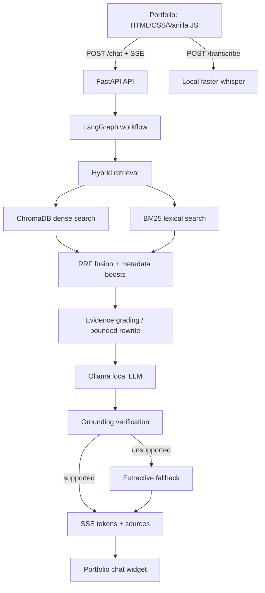

# NEXUS architecture

## Trust boundaries
- Knowledge files are untrusted content, never executable instructions.
- Only allowlisted read-only tools should be callable by the model.
- The frontend-provided history is bounded and validated; this backend does not maintain a shared global conversation history.
- Ollama and speech recognition are configured as local services. GitHub live repository lookup is an optional external metadata tool; the knowledge-grounded chat and speech pipeline do not require paid AI APIs.
- SSE events expose progress and sources but should not expose stack traces or secrets.

## Current limitations to verify
- The default voice output uses browser speech synthesis where configured; browser TTS may use OS-provided voices. For strict offline TTS across environments, add a local Piper adapter.
- Reranking is optional and adds a model download.
- Evaluation scores must be generated on the target Mac; no performance numbers are asserted by this repository.
